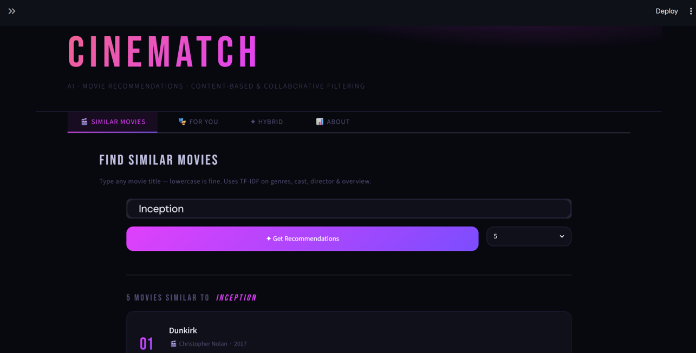

# CineMatch 🎬

AI Laboratory course project, Free University of Bozen-Bolzano, June 2026 . Full report:
[`docs/AILABreport_macek_eskicioglu.pdf`](docs/AILABreport_macek_eskicioglu.pdf)

Choosing a movie from thousands of titles takes time. We build a movie recommender web app that combines content-based filtering, collaborative filtering, a hybrid model that mixes both signals, and a cold-start model for new users. 



## Features

- **Similar movies (content-based):** search for a movie you like and get movies with similar plot, genres, cast and crew.
- **Personal recommendations (collaborative):** get recommendations from a user's rating history.
- **Hybrid:** "which movies like this one would I personally enjoy?" A slider sets the balance between the two signals.
- **New user (cold start):** rate at least three movies and get recommendations without any history.

## Data

| Dataset | Used for | Size |
|---|---|---|
| [TMDB movies](https://www.kaggle.com/datasets/matkardivesh/tmdb-230000-movies-dataset) (Kaggle) | Content-based filtering: title, genres, overview, cast, crew | about 238,000 movies |
| [MovieLens](https://grouplens.org/datasets/movielens/) (GroupLens) | Collaborative filtering: real user ratings | about 100,000 ratings, 610 users, 9,700 movies |

The two datasets share no common identifier, so we join them on normalised title and release year (±1 year tolerance). About 11.5% of MovieLens movies find no TMDB match and only get the collaborative signal in the hybrid model.

## Models

- **Content-based:** each movie's text fields are combined into one string and turned into a TF-IDF vector (50,000 terms). Movies are ranked by cosine similarity to the query movie. Similarities are computed on the fly for one query, since a precomputed 238K × 238K matrix does not fit in memory.
- **Collaborative (SVD):** matrix factorisation with the `surprise` library (50 latent factors, 20 epochs). 
It learns user and movie factors from the observed ratings only, and predicts `r̂ = μ + b_u + b_i + U_u · V_iᵀ`.
- **Hybrid:** both scores are normalised to [0, 1] and combined as `score = α · content + (1 − α) · CF`, with α set by the user in the app.
- **Cold start:** for a new user, we find the 20 most similar existing users with Pearson correlation on the shared ratings and take a weighted average of their ratings. This is combined with the content signal of the movies the user liked.

## Architecture

A Flask backend loads the models and exposes one REST endpoint per recommendation type (content-based, collaborative, hybrid, new user). A Streamlit frontend only sends requests and displays the results, so the model logic stays independent from the interface.

```
.
├── backend/            # Flask API: routes, validation, configuration
├── frontend/           # Streamlit app: pages, components, styling
├── models/             # [recommendation models, e.g. content-based, collaborative, hybrid, cold start]
├── data/               # datasets (not included, see Setup)
├── docs/               # screenshot
├── model1.ipynb        # first model experiments: SVD evaluation (RMSE, MAE) and TMDB/MovieLens overlap check
├── requirements.txt
└── .env.example        # configuration template
```

## Results

- **Collaborative filtering:** 5-fold cross-validation on the MovieLens ratings gives a mean RMSE of **0.8699** and a mean MAE of **0.6679** (RMSE standard deviation 0.0033), on a 0.5–5.0 rating scale.
- **Content-based filtering:** there is no ground truth for similarity, so we check the results qualitatively. For example, "Inception" returns Interstellar, Dunkirk and The Dark Knight Rises.
- **Hybrid:** lowering α removes movies that are textually similar but have no rating data and promotes movies the user is predicted to like (for "Inception" and user 1, The Prestige and Following replace content-only matches).

## Limitations

- Computing similarities on the fly works for one query at a time, but a larger system would need approximate nearest-neighbour search.
- The datasets are joined on title and year, which is imperfect. A dataset with a shared identifier would be cleaner.
- TF-IDF looks only at word overlap, so some odd titles can appear among the top results.
- The MovieLens data is small and old, so the collaborative model only recommends movies that exist in it.
- Partial title matching helps with typos but can pick the wrong movie when titles are substrings of each other.

## Setup

```bash
python -m venv .venv
.venv\Scripts\activate        # Windows
# source .venv/bin/activate   # Mac/Linux

pip install -r requirements.txt
```

## Data download

The dataset from TMDB movies is not included because of its size (about 150 MB).

1. Download the [TMDB 230000 Movies Dataset](https://www.kaggle.com/datasets/matkardivesh/tmdb-230000-movies-dataset) from Kaggle.
2. Place the file in the `data/` folder and name it `TMDB_230000_movies.csv`.

The MovieLens dataset is not included because of the GroupLens licence.

1. Download it from [GroupLens](https://grouplens.org/datasets/movielens/) website, choose ml-latest-small.zip folder
2. Copy  `movies.csv ` and  `ratings.csv` files into the `data/` folder

## Run

Open two terminals from the project root, both with the venv activated.

**Terminal 1 — Backend (Flask):**
```bash
python -m backend.app
```

**Terminal 2 — Frontend (Streamlit):**
```bash
streamlit run frontend/app.py
```

Then open http://localhost:8501 in your browser.

> **Note:** The first request on each tab is slow (30–40s) while models load into memory. Subsequent requests are fast.

## Team

Project by **Zeynep Eskicioğlu** and **Valentina Macek**. Valentina implements the Flask backend (API routes, validation, configuration) and Zeynep builds the Streamlit frontend (pages, components, styling). We develop the models together: Zeynep focuses on collaborative filtering, and Valentina on content-based filtering and the idea of the hybrid model.
